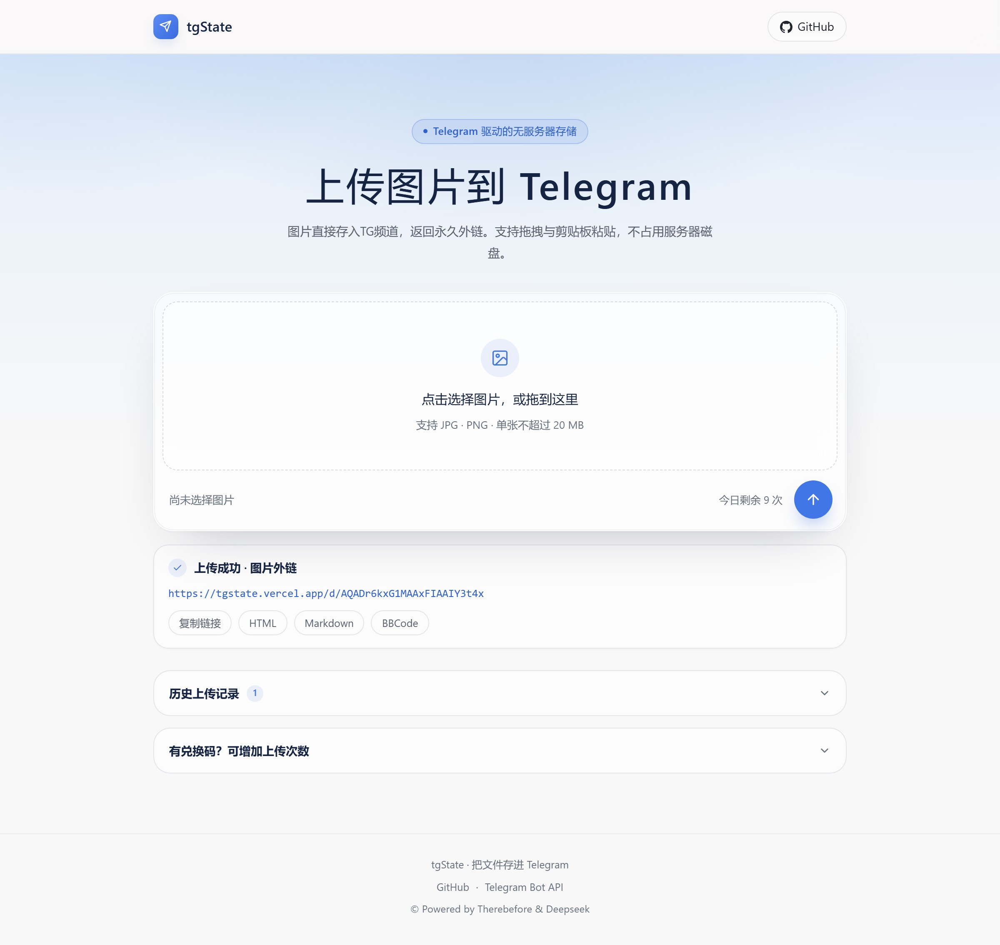

# tgState
==

[中文](https://github.com/csznet/tgState/blob/main/README.md)

A file external link system using Telegram as storage.

No restrictions on file size and format.

Can be used as a Telegram image hosting service or a Telegram cloud drive.

Supports web and Telegram direct file uploads.

Use with CloudFlare: https://github.com/csznet/tgState/blob/main/CloudFlare.md

For any questions, consult TG @tgstate123

# Demo

https://tgstate.vercel.app / https://tgstate.ikun123.com/

Hosted on Vercel, resource limitations - files larger than 5MB are not supported.

Demo image:



# UI

- Uploads show a progress bar with percentage; chunked uploads report aggregated progress
- All UI hints and error messages are in Chinese
- Supports drag & drop, clipboard paste, upload history and one-click link copying

# Parameter Description

Mandatory parameters:

- target
- token

Optional parameters:

- pass
- mode
- codes
- url
- port

## target

The target can be a channel, group, or individual.

When the target is a channel, the bot needs to be added to the channel as an administrator, make the channel public, and customize the channel link. The target value should be filled with the link, such as @xxxx.

When the target is a group, the bot needs to be added to the group, make the group public, and customize the group link. The target value should be filled with the link, such as @xxxx.

When the target is an individual, it is the Telegram ID (obtained from @getmyid_bot).

## token

Fill in your bot token.

## pass

Fill in the access password. If not needed, fill in ```none``` directly.

## mode

- Default (empty or ```i```) is image host mode: only jpg/jpeg/png images are accepted, max 20MB per image.
- ```p``` represents running in cloud drive mode, with no restriction on uploaded suffixes (files over 10MB are uploaded in chunks).
- ```m``` On top of the p mode, web upload is disabled, and upload can be done via private chat (if the target is an individual, only specified users can upload via private chat).

## Upload quota (anti-abuse)

The web page allows at most 10 uploads per browser per calendar day by default. The quota resets automatically the next day, and the page shows "今日次数已用完" once it is exhausted.

The quota is stored in the browser's localStorage (key `tgstate_quota`), so clearing browser data, using a private window, or switching browsers resets it. This is a client-side guard: it deters mistakes and casual abuse but cannot stop a determined bypass.

To change the limit, edit `dailyLimit` (a positive integer) in the `tgstate-page-config` block of `assets/templates/files.tmpl` and `assets/templates/images.tmpl`.

## Redeem codes (codes)

Configure redeem codes with the `codes` environment variable. On the page, open "有兑换码？可增加上传次数" and enter a code to add uploads for that browser or unlock unlimited uploads.

Format: `code:reward`, multiple codes separated by commas.

- A positive integer reward adds uploads (extra uploads are kept across calendar days and used after the daily quota).
- `unlimited` (also `u`, `inf`, `∞`) unlocks unlimited uploads for that browser.

Example:

```
codes=WELCOME10:10,VIP:unlimited
```

For Docker, add `-e codes=WELCOME10:10,VIP:unlimited`; for Vercel, add the `codes` environment variable to the project.

Notes:

- Codes are case-insensitive. The server only validates a code; it does not track usage (this project has no database).
- The same code can be redeemed only once per browser, but it can be redeemed again in other browsers/devices or after clearing site data. Codes therefore suit gift/invite codes, not one-time paid codes; use long random strings to avoid enumeration.
- The redeemed reward is stored in localStorage (key `tgstate_quota`) as well; it is a client-side guard that can be bypassed on purpose.

## url

The pre-domain address that bot obtains FileID is automatically filled in.

## port

Customize the running port.

# Management

## Get FIleID

Replying with ```get``` to the file reference in the bot's chat can get the FileID. Access the resource by combining the built address and the obtained path.

If the url parameter is configured, the complete address will be returned directly.


# Deployment

## Binary

Download for Linux amd64

```
wget https://github.com/csznet/tgState/releases/latest/download/tgState.zip && unzip tgState.zip && rm tgState.zip
```

Download for Linux arm64

```
wget https://github.com/csznet/tgState/releases/latest/download/tgState_arm64.zip && unzip tgState_arm64.zip && rm tgState_arm64.zip
```

**Usage**

```./tgState parameters```

**Example**

```./tgState -token xxxx -target @xxxx```

**Run in the background**

```nohup ./tgState parameters &```

## Docker

Pull the image

```docker pull csznet/tgstate:latest```


Start

```
docker run -d -p 8088:8088 --name tgstate parameters --net=host csznet/tgstate:latest
```

Where docker parameters need to be set as environment variables.

**Example**

```
docker run -d -p 8088:8088 --name tgstate -e token=aaa -e target=@bbb --net=host csznet/tgstate:latest
```

## Vercel

Image host mode caps each image at 20MB; Vercel limits request bodies to about 4.5MB, so on Vercel the effective limit is about 4.5MB. Does not support Telegram in getting file paths.

[Click here to go to the Vercel configuration page](https://vercel.com/new/clone?repository-url=https%3A%2F%2Fgithub.com%2Fcsznet%2FtgState&env=token&env=target&env=pass&env=mode&project-name=tgState&repository-name=tgState)

# API Description

POST method to the path ```/api```

Form transmission, field name is image, content is binary data.
